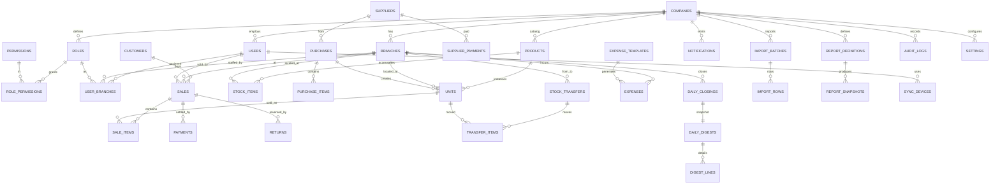

# 10 — Database Schema (Finalized · MySQL 8)

> **Status:** FINAL DESIGN for review · **MySQL 8.0+ / InnoDB** · derived from the frozen architecture ([`06`](06_TECHNICAL_ARCHITECTURE.md)) and requirements ([`07`](07_DATABASE_REQUIREMENTS.md)).
> **Design document only** — no Prisma models, SQL, or migrations are generated here (next, gated step).
> Frozen product decisions: **D4 exact per-unit cost · D9 tax-ready (deferred) · D10 ~500k units / 100k sales-yr / ≤100 branches · D11 Administrator ≠ Owner.**
>
> **Engine amended 2026-07-29: PostgreSQL → MySQL 8 (InnoDB).** MySQL-specific decisions applied throughout:
> - **M1 — App-layer tenant isolation** (MySQL has no RLS): a mandatory Prisma middleware forces `company_id` on every query; backed by RBAC + audit + a least-privilege DB user.
> - **M2 — UUIDv7 stored as `BINARY(16)`** (compact, InnoDB-clustered), generated **app-side** (offline-friendly).
> - **M3 — Generated columns** replace Postgres partial indexes (sold-once, company-wide settings).
> - **M4 — `DATETIME(6)` in UTC** replaces `timestamptz`.
> - **M5 — Rollup tables** replace materialized views (BI).
> - **M6 — `FULLTEXT`** replaces GIN for product search.

---

## 1. Design conventions (MySQL 8 / InnoDB)

| Concern | Standard | Rationale |
|---|---|---|
| **Engine / charset** | **InnoDB**, `utf8mb4` / `utf8mb4_0900_ai_ci` | FK + transactions; full Unicode; MySQL 8 default collation. |
| **Primary keys** | **`BINARY(16)` UUIDv7**, generated app-side (Prisma `Bytes @db.Binary(16)`) | InnoDB clusters on PK; time-ordered UUIDv7 → sequential inserts + compact secondary indexes (M2). Offline devices mint IDs without collision. |
| **High-volume PK exception** | `audit_logs` uses `BIGINT AUTO_INCREMENT` | Ordered, compact, append-only. |
| **Tenancy** | `company_id BINARY(16) NOT NULL` on **every** table (incl. line tables, R2) | App-layer isolation (M1) filters by it; also enables future partitioning. |
| **Money** | `DECIMAL(14,2)`, single currency (`companies.currency`) | Exact decimal; **never float**. |
| **Quantities** | `INT`, `CHECK (>= 0)` | Phones are individual `units` rows. |
| **Timestamps** | `DATETIME(6)` stored **UTC** (M4); `created_at DEFAULT CURRENT_TIMESTAMP(6)` | MySQL `TIMESTAMP` has a 2038 limit + tz conversion; `DATETIME` UTC-by-convention avoids both. |
| **Booleans** | `TINYINT(1)` (Prisma `Boolean`) | MySQL convention. |
| **Enums** | Native inline `ENUM('...')` (Prisma enum) | No `CREATE TYPE` needed in MySQL. |
| **JSON** | `JSON` | Settings, audit before/after, import payloads. |
| **Soft delete** | `deleted_at DATETIME(6) NULL` on **master data only** | Financial rows are **reversed, never deleted**. |
| **IMEI** | `VARCHAR(15)` + `CHECK (... REGEXP '^[0-9]{15}$')` + Luhn in app | Integrity at the DB edge (MySQL 8.0.16+ enforces CHECK). |
| **Naming** | `snake_case`, plural tables, `<entity>_id` FKs | Consistency. |

**UUIDv7 handling (M2):** IDs are 16-byte binary. Prisma models them as `Bytes`; the app/seed generate a UUIDv7 `Buffer` (offline-friendly) and a helper renders them as canonical strings for the API/logs. An **optional** MySQL function `uuid_v7_bin()` is provided for raw SQL, but app-side generation is primary.

**Tax-ready seam (D9):** priced lines store explicit **net** amounts; `sales`/`purchases` carry `tax_total DECIMAL(14,2) NOT NULL DEFAULT 0`, lines carry `tax_amount DEFAULT 0`, `products.tax_rate` reserved. v2 populates these — no structural change.

**Multi-currency seam (R8):** currency on `companies.currency` in v1; monetary tables can later add a per-transaction `currency` (+ `fx_rate`) via `ALTER TABLE ... ADD COLUMN` with no restructure.

**Column legend:** **Null** = Y/N. **PK/FK/UQ** as marked. All `id`/`*_id` columns are `BINARY(16)` unless noted.

---

## 2. Complete ERD

**Cardinalities:** Company **1—∞** everything (via `company_id`); User **∞—∞** Branch via `user_branches` (role per branch); Role **∞—∞** Permission via `role_permissions`; Product **1—∞** Units / StockItems; Sale **1—∞** SaleItems/Payments/Returns; SaleItem **∞—1** Unit; DailyClosing **1—1** DailyDigest **1—∞** DigestLines.

---

## 3. Enumerations (MySQL native `ENUM`)

| Enum | Values |
|---|---|
| role_key | owner, administrator, branch_manager, sales_employee, warehouse_employee |
| branch_type | store, warehouse |
| product_category | phone, accessory, other |
| unit_status | in_stock, reserved, sold, returned, faulty, in_transit, transferred_out |
| purchase_status | paid, partial, unpaid |
| sale_pay_status | paid, partial, credit |
| payment_method | cash, card, mobile, bank, other |
| transfer_status | in_transit, received, cancelled |
| expense_recurrence | none, monthly, yearly |
| import_status | parsing, preview, committed, failed |
| import_row_status | valid, warning, error |
| audit_action | create, update, delete, status_change, override, login, logout |
| sync_status | pending, accepted, conflict, rejected |

---

## 4. Tenancy & Access

### 4.1 companies
| Column | Type | Null | Default | Notes |
|---|---|---|---|---|
| id | BINARY(16) | N | (app UUIDv7) | **PK** |
| name | VARCHAR(160) | N | — | |
| currency | CHAR(3) | N | 'USD' | single currency v1 |
| timezone | VARCHAR(64) | N | 'UTC' | display tz |
| settings | JSON | N | (json) | health weights, discount toggle, WA schedule |
| is_active | TINYINT(1) | N | 1 | |
| created_at / updated_at | DATETIME(6) | N | CURRENT_TIMESTAMP(6) | UTC |

### 4.2 branches
| Column | Type | Null | Default | Notes |
|---|---|---|---|---|
| id | BINARY(16) | N | — | **PK** |
| company_id | BINARY(16) | N | — | **FK** → companies |
| name | VARCHAR(160) | N | — | |
| type | ENUM(branch_type) | N | 'store' | |
| address | VARCHAR(255) | Y | — | |
| phone | VARCHAR(40) | Y | — | |
| is_active | TINYINT(1) | N | 1 | |
| created_at / updated_at | DATETIME(6) | N | CURRENT_TIMESTAMP(6) | |
| deleted_at | DATETIME(6) | Y | — | soft delete |

**UQ** (company_id, name).

### 4.3 users
| Column | Type | Null | Notes |
|---|---|---|---|
| id | BINARY(16) | N | **PK** |
| company_id | BINARY(16) | N | **FK** |
| name | VARCHAR(160) | N | |
| login | VARCHAR(120) | N | phone/username |
| password_hash | VARCHAR(255) | N | Argon2id |
| pin_hash | VARCHAR(255) | Y | optional device unlock |
| is_active | TINYINT(1) | N | default 1 |
| last_login_at | DATETIME(6) | Y | |
| created_at / updated_at | DATETIME(6) | N | |
| deleted_at | DATETIME(6) | Y | soft delete |

**UQ** (company_id, login).

### 4.4 roles
| Column | Type | Null | Notes |
|---|---|---|---|
| id | BINARY(16) | N | **PK** |
| company_id | BINARY(16) | N | **FK** |
| key | ENUM(role_key) | N | |
| name | VARCHAR(80) | N | |

**UQ** (company_id, key).

### 4.5 permissions *(global catalog, not tenant-scoped)*
| Column | Type | Null | Notes |
|---|---|---|---|
| id | BINARY(16) | N | **PK** |
| key | VARCHAR(80) | N | **UQ** e.g. `sale.create` |
| label | VARCHAR(160) | N | |

**17 permission keys (R7):** `sale.create, sale.return, cost.view, discount.apply, discount.override, unit.add, unit.transfer, import.run, purchase.manage, supplier.manage, expense.manage, closing.perform, report.view, branch.manage, user.manage, settings.manage, integrations.manage`.

### 4.6 role_permissions
| Column | Type | Null | Notes |
|---|---|---|---|
| company_id | BINARY(16) | N | **FK** |
| role_id | BINARY(16) | N | **PK/FK** → roles |
| permission_id | BINARY(16) | N | **PK/FK** → permissions |

**PK** (role_id, permission_id). `cost.view` not granted to Administrator by default (D11).

### 4.7 user_branches
| Column | Type | Null | Notes |
|---|---|---|---|
| id | BINARY(16) | N | **PK** |
| company_id | BINARY(16) | N | **FK** |
| user_id | BINARY(16) | N | **FK** → users |
| branch_id | BINARY(16) | N | **FK** → branches |
| role_id | BINARY(16) | N | **FK** → roles (role per branch) |

**UQ** (user_id, branch_id).

---

## 5. Catalog & Inventory

### 5.1 products
| Column | Type | Null | Default | Notes |
|---|---|---|---|---|
| id | BINARY(16) | N | — | **PK** |
| company_id | BINARY(16) | N | — | **FK** |
| brand | VARCHAR(80) | N | — | |
| model | VARCHAR(120) | N | — | |
| variant | VARCHAR(120) | Y | — | storage/color |
| category | ENUM(product_category) | N | 'phone' | |
| is_serialized | TINYINT(1) | N | 1 | |
| default_cost | DECIMAL(14,2) | Y | — | |
| default_price | DECIMAL(14,2) | Y | — | |
| reorder_threshold | INT | N | 0 | |
| tax_rate | DECIMAL(6,4) | Y | — | **reserved v2** |
| created_at / updated_at | DATETIME(6) | N | CURRENT_TIMESTAMP(6) | |
| deleted_at | DATETIME(6) | Y | — | |

**UQ** (company_id, brand, model, variant). **FULLTEXT** (brand, model, variant) — M6.

### 5.2 tac_catalog *(global TAC → model lookup for auto-recognition)*
| Column | Type | Null | Notes |
|---|---|---|---|
| tac | CHAR(8) | N | **PK** (first 8 IMEI digits) |
| brand | VARCHAR(80) | Y | |
| model | VARCHAR(120) | Y | |
| default_variant | VARCHAR(120) | Y | |

### 5.3 units ★ *(IMEI-tracked physical phone — heart of the system)*
| Column | Type | Null | Default | Notes |
|---|---|---|---|---|
| id | BINARY(16) | N | — | **PK** |
| company_id | BINARY(16) | N | — | **FK** |
| product_id | BINARY(16) | N | — | **FK** → products |
| branch_id | BINARY(16) | N | — | **FK** → branches (location) |
| supplier_id | BINARY(16) | Y | — | **FK** → suppliers |
| purchase_id | BINARY(16) | Y | — | **FK** → purchases |
| imei_primary | VARCHAR(15) | N | — | **UQ**, `CHECK REGEXP '^[0-9]{15}$'` |
| imei_secondary | VARCHAR(15) | Y | — | **UQ** (MySQL allows multiple NULLs → unique-when-present) |
| serial_no | VARCHAR(60) | Y | — | |
| cost | DECIMAL(14,2) | N | — | **exact per-unit cost (D4)** |
| status | ENUM(unit_status) | N | 'in_stock' | |
| date_in | DATETIME(6) | N | CURRENT_TIMESTAMP(6) | |
| date_sold | DATETIME(6) | Y | — | |
| image_ref | VARCHAR(512) | Y | — | S3 key |
| created_at / updated_at | DATETIME(6) | N | CURRENT_TIMESTAMP(6) | |
| created_by / updated_by | BINARY(16) | Y | — | **FK** → users |

**UQ** (imei_primary), (imei_secondary). **Index** (company_id, branch_id, status). Sold-once enforced via `sale_items` generated column (§6.7).

### 5.4 stock_items *(non-serialized accessories)*
| Column | Type | Null | Notes |
|---|---|---|---|
| id | BINARY(16) | N | **PK** |
| company_id | BINARY(16) | N | **FK** |
| product_id | BINARY(16) | N | **FK** → products |
| branch_id | BINARY(16) | N | **FK** → branches |
| quantity | INT | N | default 0, `CHECK (>= 0)` |
| cost | DECIMAL(14,2) | N | |
| price | DECIMAL(14,2) | N | |
| created_at / updated_at | DATETIME(6) | N | |

**UQ** (company_id, product_id, branch_id).

---

## 6. Suppliers, Purchases & Sales

### 6.1 suppliers
id **PK**, company_id **FK**, name VARCHAR(160), phone VARCHAR(40)?, notes TEXT?, balance DECIMAL(14,2) default 0, created_at/updated_at, deleted_at?. **UQ** (company_id, name).

### 6.2 purchases
| Column | Type | Null | Notes |
|---|---|---|---|
| id | BINARY(16) | N | **PK** |
| company_id / branch_id / supplier_id | BINARY(16) | N | **FK** |
| user_id | BINARY(16) | Y | **FK** → users |
| reference_no | VARCHAR(40) | Y | supplier invoice |
| date | DATETIME(6) | N | |
| subtotal / total | DECIMAL(14,2) | N | net |
| tax_total | DECIMAL(14,2) | N | default 0 (**v2**) |
| amount_paid | DECIMAL(14,2) | N | default 0 |
| status | ENUM(purchase_status) | N | 'unpaid' |
| due_date | DATE | Y | |
| created_at / updated_at | DATETIME(6) | N | |

### 6.3 purchase_items
id **PK**, company_id **FK**, purchase_id **FK** (ON DELETE CASCADE), product_id **FK**, quantity INT `CHECK (>0)`, unit_cost DECIMAL(14,2), tax_amount DECIMAL(14,2) default 0 (**v2**). Serialized lines create `units`.

### 6.4 supplier_payments
id **PK**, company_id **FK**, supplier_id **FK**, purchase_id **FK**?, amount DECIMAL(14,2), method ENUM(payment_method), paid_at DATETIME(6), created_by **FK**?.

### 6.5 customers *(lightweight)*
id **PK**, company_id **FK**, name VARCHAR(160)?, phone VARCHAR(40)?, notes TEXT?, balance DECIMAL(14,2) default 0 (receivable), created_at/updated_at, deleted_at?.

### 6.6 sales
| Column | Type | Null | Notes |
|---|---|---|---|
| id | BINARY(16) | N | **PK** |
| company_id / branch_id / user_id | BINARY(16) | N | **FK** (user = seller) |
| customer_id | BINARY(16) | Y | **FK** |
| invoice_no | VARCHAR(24) | N | **UQ per branch**, human-readable |
| sold_at | DATETIME(6) | N | |
| subtotal / total / total_cost / margin | DECIMAL(14,2) | N | `total_cost` = Σ unit costs (D4) |
| discount / tax_total / amount_paid / balance_due | DECIMAL(14,2) | N | default 0 (tax_total **v2**) |
| pay_status | ENUM(sale_pay_status) | N | 'paid' |
| due_date | DATE | Y | credit |
| is_reversed | TINYINT(1) | N | default 0 |
| client_uuid | BINARY(16) | Y | **UQ**, offline idempotency |
| created_at / updated_at | DATETIME(6) | N | |

**UQ** (branch_id, invoice_no), (client_uuid). **Index** (company_id, branch_id, sold_at), (company_id, user_id, sold_at).

### 6.7 sale_items
| Column | Type | Null | Notes |
|---|---|---|---|
| id | BINARY(16) | N | **PK** |
| company_id / sale_id | BINARY(16) | N | **FK** (sale ON DELETE CASCADE) |
| unit_id | BINARY(16) | Y | **FK** → units (serialized) |
| product_id | BINARY(16) | Y | **FK** → products (accessory) |
| quantity | INT | N | default 1, `CHECK (>0)` |
| price / cost | DECIMAL(14,2) | N | captured at sale (D4) |
| discount / tax_amount | DECIMAL(14,2) | N | default 0 (tax **v2**) |
| voided | TINYINT(1) | N | default 0 (set on return) |
| **active_unit_id** | BINARY(16) | (gen) | **GENERATED** `AS (IF(voided=0, unit_id, NULL)) VIRTUAL` |

**★ Sold-once (M3):** `UNIQUE (active_unit_id)`. MySQL allows multiple NULLs, so voided/accessory lines don't collide, but an active phone line enforces **one active sale per unit** — and a returned unit (line voided → NULL) can be sold again. `CHECK (unit_id IS NOT NULL OR product_id IS NOT NULL)`.

### 6.8 payments
id **PK**, company_id **FK**, sale_id **FK** (CASCADE), method ENUM(payment_method), amount DECIMAL(14,2), paid_at DATETIME(6). Σ payments = `sales.amount_paid` (rule engine).

### 6.9 returns *(reverses a sale; never a hard delete)*
id **PK**, company_id **FK**, sale_id **FK**, sale_item_id **FK**?, unit_id **FK**?, reason VARCHAR(255)?, refund_amount DECIMAL(14,2) default 0, restock TINYINT(1) default 1, returned_at DATETIME(6), created_by **FK**?. Voids the `sale_item`, restores the unit, adjusts balances — all logged.

---

## 7. Branch Transfers

### 7.1 stock_transfers
id **PK**, company_id **FK**, from_branch_id / to_branch_id **FK** → branches, status ENUM(transfer_status) 'in_transit', sent_by/received_by **FK**?, sent_at DATETIME(6), received_at DATETIME(6)?. `CHECK (from_branch_id <> to_branch_id)`.

### 7.2 transfer_items
id **PK**, company_id **FK**, transfer_id **FK** (CASCADE), unit_id **FK**?, product_id **FK**?, quantity INT default 1 `CHECK (>0)`. Units carry `in_transit` until received.

---

## 8. Finance, Closing & Notification Center

### 8.1 expense_templates
id **PK**, company_id **FK**, branch_id **FK**? (null = company-wide), category VARCHAR(60), amount DECIMAL(14,2), recurrence ENUM(expense_recurrence) 'monthly', day_of_month SMALLINT?, is_active TINYINT(1) default 1.

### 8.2 expenses
id **PK**, company_id **FK**, branch_id **FK**?, template_id **FK**?, category VARCHAR(60), amount DECIMAL(14,2), spent_on DATE, note TEXT?, created_by **FK**?, created_at/updated_at. Feed monthly/yearly **net profit = gross margin − expenses**.

### 8.3 daily_closings
id **PK**, company_id **FK**, branch_id **FK**, closing_date DATE, expected_cash/counted_cash/difference/total_sales/total_profit DECIMAL(14,2), is_locked TINYINT(1) default 1, notes TEXT?, closed_by **FK**?, closed_at DATETIME(6). **UQ** (branch_id, closing_date).

### 8.4 daily_digests ★ *(full in-app snapshot; WhatsApp gets only these three totals)*
id **PK**, company_id **FK**, branch_id **FK**, closing_id **FK**? **UQ**, digest_date DATE, revenue/cost_of_goods_sold/gross_profit DECIMAL(14,2), generated_at DATETIME(6). **UQ** (branch_id, digest_date).

### 8.5 digest_lines *(one per sold unit — detail stays in-app)*
id **PK**, company_id **FK**, digest_id **FK** (CASCADE), imei VARCHAR(15)?, product_label VARCHAR(200)?, employee_id **FK**?, sale_price/purchase_cost/profit DECIMAL(14,2)?, method ENUM(payment_method)?, sold_at DATETIME(6)?.

---

## 9. System: Notifications, Import, Reports, Audit, Sync, Settings

### 9.1 notifications
id **PK**, company_id **FK**, branch_id **FK**?, target_user_id **FK**? (null = broadcast), type VARCHAR(60), title VARCHAR(200), body TEXT?, action_link VARCHAR(255)?, is_read TINYINT(1) default 0, created_at DATETIME(6). **Index** (company_id, target_user_id, is_read, created_at).

### 9.2 import_batches / import_rows
- **import_batches:** id **PK**, company_id/branch_id **FK**, user_id **FK**?, file_ref VARCHAR(512), status ENUM(import_status) 'parsing', total_rows/valid_rows/error_rows INT default 0, created_at/updated_at.
- **import_rows:** id **PK**, company_id **FK**, batch_id **FK** (CASCADE), row_number INT, raw JSON?, parsed JSON?, status ENUM(import_row_status), message TEXT?.

### 9.3 report_definitions / report_snapshots
- **report_definitions:** id **PK**, company_id **FK**, name VARCHAR(160), type VARCHAR(60), params JSON, owner_user_id **FK**?, created_at.
- **report_snapshots:** id **PK**, company_id **FK**, definition_id **FK** (CASCADE), range_start/range_end DATE?, file_ref VARCHAR(512)?, generated_at DATETIME(6).

### 9.4 audit_logs ★ *(append-only; app user has no UPDATE/DELETE)*
| Column | Type | Null | Notes |
|---|---|---|---|
| id | BIGINT | N | **PK** AUTO_INCREMENT (ordered) |
| company_id | BINARY(16) | N | **FK** |
| branch_id | BINARY(16) | Y | |
| user_id | BINARY(16) | Y | **FK** → users |
| entity_type | VARCHAR(60) | N | |
| entity_id | BINARY(16) | Y | |
| action | ENUM(audit_action) | N | |
| before / after | JSON | Y | |
| reason | TEXT | Y | override justification |
| ip | VARCHAR(45) | Y | IPv4/IPv6 text |
| at | DATETIME(6) | N | CURRENT_TIMESTAMP(6) |

**Index** (company_id, entity_type, entity_id, at). Immutability enforced by **REVOKE UPDATE, DELETE** from the app DB user.

### 9.5 settings
| Column | Type | Null | Notes |
|---|---|---|---|
| id | BINARY(16) | N | **PK** |
| company_id | BINARY(16) | N | **FK** |
| branch_id | BINARY(16) | Y | **FK** (null = company-wide) |
| key | VARCHAR(80) | N | |
| value | JSON | N | |
| **branch_scope** | BINARY(16) | (gen) | **GENERATED** `AS (COALESCE(branch_id, 0x00…00)) VIRTUAL` |

**UQ (M3)** (company_id, branch_scope, key) — the generated `branch_scope` gives company-wide keys (branch_id NULL) a real value so uniqueness holds even for the NULL case. **Keys:** `low_stock_threshold`, `dead_stock_days`, `discount_monitoring_enabled` (default **false**), `discount_limits_by_role`, `health_score_weights`, `whatsapp_schedule`, `invoice_no_format`.

### 9.6 sync_devices
id **PK**, company_id **FK**, user_id **FK**, device_id VARCHAR(120), last_pull_cursor BIGINT?, last_seen_at DATETIME(6)?. **UQ** (user_id, device_id).

### 9.7 outbox_changes *(server mirror for idempotency + conflict audit)*
id **BINARY(16) PK** (client-generated UUIDv7), company_id **FK**, device_id VARCHAR(120) (plain column, no FK), entity_type VARCHAR(60), entity_id BINARY(16)?, op VARCHAR(20), payload JSON?, status ENUM(sync_status) 'pending', reason TEXT?, received_at DATETIME(6). **Index** (company_id, status), (device_id).

---

## 10. Index strategy (MySQL)

| Purpose | Index |
|---|---|
| **IMEI uniqueness & scan** | `UNIQUE (imei_primary)` on units |
| Dual-SIM secondary | `UNIQUE (imei_secondary)` — multiple NULLs allowed ⇒ unique-when-present |
| **Sold-once (M3)** | `UNIQUE (active_unit_id)` on sale_items (generated column) |
| Company-wide settings (M3) | `UNIQUE (company_id, branch_scope, key)` on settings (generated column) |
| Inventory/dashboards | `(company_id, branch_id, status)` on units |
| Sales reporting | `(company_id, branch_id, sold_at)` on sales |
| Employee analytics | `(company_id, user_id, sold_at)` on sales |
| Receipt uniqueness | `UNIQUE (branch_id, invoice_no)` |
| Offline idempotency | `UNIQUE (client_uuid)` on sales |
| Accessory stock | `UNIQUE (company_id, product_id, branch_id)` on stock_items |
| Product search (M6) | `FULLTEXT (brand, model, variant)` on products |
| Audit queries | `(company_id, entity_type, entity_id, at)` on audit_logs |
| Notifications | `(company_id, target_user_id, is_read, created_at)` |

**All FK columns are indexed** — InnoDB requires an index on referencing columns (auto-created if absent). Composite indexes lead with `company_id` because every tenant query filters on it.

---

## 11. Business rules enforced by the schema
1. **IMEI globally unique**, 15-digit (`UNIQUE` + `CHECK REGEXP`).
2. **Sold-once, return-aware** via the `active_unit_id` generated column + `UNIQUE` (M3).
3. **Quantities ≥ 0** (`CHECK`); balances managed by the rule engine.
4. **Payments reconcile** to `amount_paid`; lines reconcile to `subtotal` (rule engine + transaction).
5. **Money never hard-deleted** — `returns` + `is_reversed`, all in `audit_logs`.
6. **One closing/digest per (branch, date)** (`UNIQUE`).
7. **Human-readable receipts** unique per branch (`UNIQUE (branch_id, invoice_no)`).
8. **Exact per-unit costing (D4):** `units.cost` → `sale_items.cost` → `sales.total_cost`/`margin`.
9. **Cost/profit visibility** gated by the `cost.view` permission — stripped server-side.
10. **Tax-ready (D9):** reserved columns default 0; v2 populates, no restructure.
11. **Discount monitoring opt-in:** `settings.discount_monitoring_enabled` default false.
12. **Tenant isolation (M1):** enforced in the backend (app-layer), not by the DB — every query carries `company_id`.

**App-enforced (not DB CHECKs) — MySQL limitation (error 3823):** a column in a FK with a referential action cannot appear in a `CHECK`. These three rules are therefore validated in the application layer, not by DB constraints:
- `sale_items`: `unit_id` **or** `product_id` present.
- `transfer_items`: `unit_id` **or** `product_id` present.
- `stock_transfers`: `from_branch_id` ≠ `to_branch_id`.

---

## 12. Foreign-key behavior (InnoDB)
- Actions used: **CASCADE** (line items → parent, e.g. sale_items→sales, payments→sales, purchase_items→purchases, transfer_items→transfers, digest_lines→digests, import_rows→batches, role_permissions→roles/permissions, report_snapshots→definitions, user_branches→users/branches, sync_devices→users); **SET NULL** (optional references: supplier/purchase/customer/created_by/etc.); **RESTRICT** (protect referenced masters: units→products/branches, sale_items→units/products, sales→branch/user, company on all).
- **MySQL notes:** `RESTRICT` and `NO ACTION` are identical in InnoDB (checks are immediate — no deferred constraints). `SET NULL` requires the FK column to be nullable (it is, where used). InnoDB auto-indexes FK columns.
- All FKs stay within one `company_id` (enforced by the service layer; not a DB constraint).

---

## 13. Query optimization (MySQL / InnoDB)
- **Clustered PK = UUIDv7 BINARY(16):** rows physically ordered by a time-ordered key → sequential inserts, minimal page splits (unlike random UUIDv4). Secondary indexes store the 16-byte PK, so keeping it BINARY(16) (not CHAR(36)) keeps them ~2.25× smaller.
- **Every hot query is tenant-scoped** → composite indexes lead with `company_id`; the app-layer filter (M1) always supplies it, so these indexes are used.
- **Dashboards read rollup tables** (M5), never scan base tables live.
- **Covering indexes** where useful (e.g. sales listing by branch/date).
- **Read replica** (RDS/Aurora) for BI/reporting isolates analytics from the selling path.

---

## 14. Scalability (D10: ~500k units, ~100k sales/yr, ≤100 branches)
- Comfortable for a single MySQL 8 instance with correct indexing — **no partitioning at v1** (avoids MySQL's "partition key must be in every unique key" constraint that would force `company_id` into every PK/UQ).
- **Partition-ready later:** if needed, range/list-partition `units`/`sales`/`audit_logs` by time or `company_id` (adjusting unique keys accordingly).
- **Rollup tables (M5)** refreshed by BullMQ jobs + Redis cache for dashboard/BI speed.
- **audit_logs:** `BIGINT AUTO_INCREMENT` PK for ordered appends. **Retention (R5): ~2 years hot, older rows ARCHIVED (never deleted)** to cold storage/an archive table, still queryable for compliance/investigations/history.
- **UUIDv7 BINARY(16)** keeps index locality good at scale.

---

## 15. Security model (MySQL)
- **Tenant isolation (M1, replaces RLS):** enforced in the backend — a mandatory Prisma middleware/extension injects `company_id` (+ branch) into **every** read and write; requests carry the tenant from the auth context. Covered by unit/integration tests and code review. *Trade-off vs Postgres RLS: the DB no longer fails closed on a missing filter, so the middleware + a repository pattern + tests are the safeguard.*
- **RBAC:** roles/permissions checked server-side; cost/profit columns **stripped** for roles lacking `cost.view`.
- **Two DB users:** `phonestore_migrator` (DDL + full DML, runs migrations/seed) and `phonestore_app` (runtime DML). **`audit_logs` is append-only for the app user, enforced by `BEFORE UPDATE`/`BEFORE DELETE` triggers** that block modification when `USER()` is the app account (an admin/DBA can still archive). *MySQL note: a schema-level GRANT cannot be table-revoked (partial_revokes is schema-level only), so triggers — not `REVOKE` — provide the guarantee.* *(No RLS-bypass concept needed — MySQL has no RLS.)*
- **Passwords/PINs:** Argon2id (`password_hash`, optional `pin_hash`), never plaintext.
- **Encryption:** TLS to the DB; at rest via RDS/Aurora KMS or InnoDB tablespace encryption; secrets in AWS Secrets Manager (never in the app bundle).
- **No hard deletes of financial data;** soft delete limited to master data.
- **PII minimization:** staff + lightweight customer contact only; payments store method + amount (no card data).
- **Backups:** automated daily + PITR (RDS/Aurora), tested restores, encrypted off-site.

---

## 16. Implementation decisions (✅ approved)

| # | Decision | Resolution |
|---|---|---|
| R1 | Tenant isolation | ✅ **App-layer** (Prisma middleware + RBAC + audit). *MySQL has no RLS (M1).* |
| R2 | `company_id` on line tables | ✅ **Denormalized onto all tables.** |
| R3 | Primary key type | ✅ **UUIDv7 stored as `BINARY(16)`**, app-side generation (M2). |
| R4 | Invoice numbering | ✅ **Per-branch sequential** + configurable prefix (`invoice_no_format`). |
| R5 | Audit retention | ✅ **2 years hot, then ARCHIVE (never delete).** |
| R6 | Health/threshold defaults | ✅ **Ship defaults in `settings`**, configurable later. |
| R7 | Permission catalog | ✅ **17 keys.** |
| R8 | Currency | ✅ **Single currency v1**, multi-currency seam reserved. |

**MySQL-specific (M1–M6):** app-layer isolation · BINARY(16) UUIDv7 · generated-column uniqueness · DATETIME(6) UTC · rollup tables · FULLTEXT search.

---

## 17. Next step (gated)
Rewrite the database layer as **code** for MySQL — a *major implementation* under `CLAUDE.md`, requiring its own approval:
1. `schema.prisma` → `provider = "mysql"`, `Bytes @db.Binary(16)` ids, `DateTime @db.DateTime(6)`, enums, `@db.Decimal(14,2)`.
2. Migration `0001_init` (MySQL DDL) + `0002_mysql_extras` (generated columns, FULLTEXT, CHECK, optional `uuid_v7_bin()`, app-user grants + audit REVOKE).
3. `seed.ts` adjusted for BINARY(16) ids (UUIDv7 → Buffer).
4. DB config: `.env` MySQL URL, drop docker-compose Postgres in favor of the WAMP MySQL (or a MySQL container), roles bootstrap as MySQL `CREATE USER/GRANT`.

*(The existing `backend/` Postgres artifacts — schema.prisma, migrations 0001/0002, 00_roles.sql, docker-compose — will be replaced.)*
